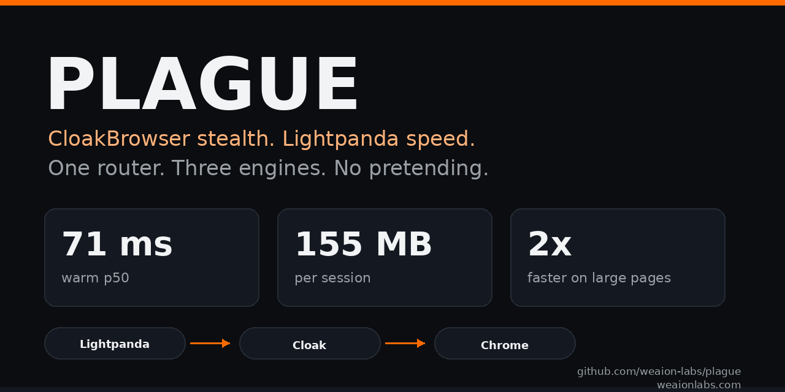

# Weaion Labs org profile snippet

Add this to `weaion-labs/.github` in `profile/README.md` as a Weaion Labs
account. Do not commit it from a personal account.

```markdown
### Featured: Plague

[](https://github.com/weaion-labs/plague)

A tiered browser router: Lightpanda speed, CloakBrowser stealth, one API.
Warm batch mode is about 7x lighter than Chrome on memory, with reproducible
benchmarks and an MCP server for agents.

[Repository](https://github.com/weaion-labs/plague) · [Benchmarks](https://github.com/weaion-labs/plague/blob/main/benchmarks/README.md)
```

## Placement

- Put it near the top of the profile README, after the intro.
- Keep the social preview at 1280x640; it is already in the repository.
- Link to the repository and the benchmark page, not to a personal fork.
- Use the Weaion Labs GitHub account for the commit.
